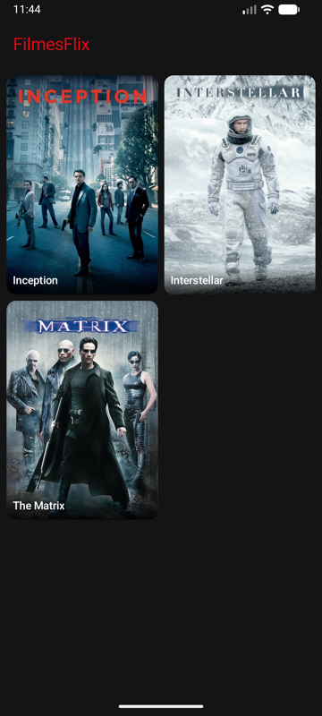

# FilmesFlix

Android app de catálogo de filmes consumindo um BFF próprio. Começou como exercício de
MVVM/Clean Architecture e foi modernizado para a stack atual de mercado.

| Lista | Detalhe |
|---|---|
|  |  |

## Stack

- **UI**: Jetpack Compose (Material 3), Navigation Compose, `LazyVerticalGrid`
- **Estado**: `StateFlow` + `viewModelScope`, `UiState` sealed (Loading / Success / Error)
- **DI**: Hilt (`@HiltViewModel`, `SavedStateHandle` para args de navegação)
- **Dados**: offline-first — Room como fonte de verdade (`Flow` do DAO) + refresh via
  Retrofit `suspend` + kotlinx.serialization + OkHttp logging
- **Arquitetura**: Clean Architecture em camadas (`data` / `domain` / `presentation`), MVVM
- **Build**: Kotlin DSL + version catalog, AGP 8.6, Kotlin 2.0, Gradle 8.10, KSP
- **Testes**: JUnit4, kotlinx-coroutines-test + Turbine, `ContractTest` validando DTOs
  contra o `openapi.yaml` do workspace, JaCoCo (≥50% geral / ≥80% em `domain`)

```
presentation/  MainActivity + NavHost, MovieListScreen, MovieDetailScreen, ViewModels, theme
domain/        model Movie, MovieRepository (interface), use cases (observe*/refresh*)
data/          remote (Retrofit DTOs), local (Room), mapper, MovieRepositoryImpl
di/            AppModule (Retrofit/Room), RepositoryModule
```

## Pré-requisitos

- **JDK 17**
- Android SDK (`platforms;android-35`, `build-tools;35.0.0`)

## Como rodar

```bash
echo "sdk.dir=$HOME/Library/Android/sdk" > local.properties   # macOS
./gradlew assembleDebug                                     # build
./gradlew testDebugUnitTest jacocoTestReport                # testes + coverage
```

O app consome `http://10.0.2.2:8080/` (loopback do emulador). Sem o BFF no ar, a lista
mostra os dados cacheados no Room; em aparelho físico, ajuste `BASE_URL` em `di/AppModule.kt`
para o IP da máquina.

> Este repositório também é usado como submódulo do
> [FilmesFlix-Workspace](https://github.com/GuerraAna/FilmesFlix-Workspace) — lá vivem o BFF,
> o contrato OpenAPI e as slice specs.
